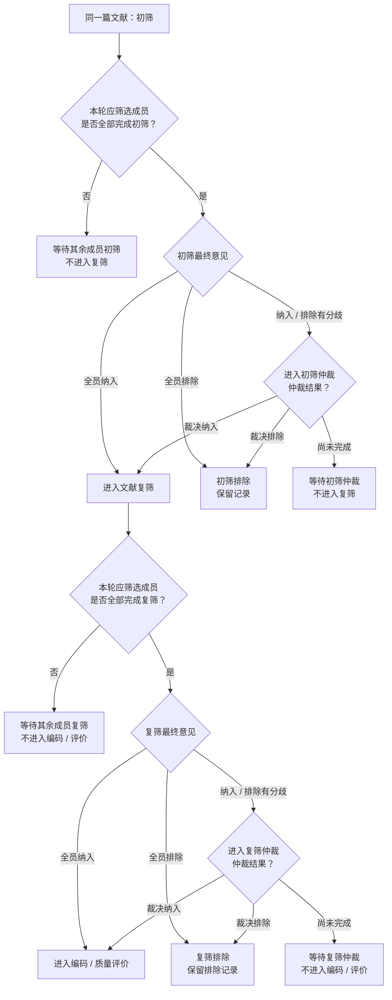

# 团队文献筛选逐条流转规则 — 已确认 v1

日期：2026-11-14。状态：**用户已通过所引用流程图及三个补充理解，并明确指示“理解正确，开始吧”**。本文件是后续产品审查与修复的验收基准，不代表当前产品已合规。成员残留为 TEAM-01，逐条流转资格为 FLOW-01；两项按接口和身份来源共同核查。

## 核心单位

推进以**同一篇文献、同一筛选轮次**为单位。一名成员完成自己的筛选，不足以使文献进入下一阶段；也不要求整批文献全部完成，已满足条件的单篇文献可以先推进。

用户已确认：“全员”指该任务中**本轮应参与筛选的全部有效成员**；只承担管理或仲裁而未承担本轮筛选的人不被额外要求投票。已移除的成员不再作为待完成成员，历史筛选与审计记录保留。有效身份仍需按既有合法工作流和来源证据识别，不能仅凭无账号或无成员表行排除。成员变更对历史已完成条目的处理不在未审核前自动改写。

## 决策流程

## 用户已确认的补充分支

1. 初筛和复筛中，全员一致排除、或仲裁最终排除，均结束该文献的推进；保留历史和排除记录。这是对用户描述中正向推进分支的补齐。
2. “全员”的计算范围采用上面的有效参与成员定义；移除成员不继续作为等待对象，保留其历史记录。
3. 本次已确认的冲突门槛是“纳入/排除结论不一致”。不能因“均排除但排除理由不同”自行增加新的推进阻塞；若未来需要理由仲裁，再单独制定规则。

## 确认后的审查边界

- 对每篇文献检查初筛完成性、冲突状态及最终仲裁结果，统一决定复筛资格。
- 对每篇文献检查复筛完成性、冲突状态及最终仲裁结果，统一决定编码/评价资格。
- 队列、计数、详情与实际保存接口应遵守同一资格规则；不能靠个人完成状态或直接调用接口提前推进。
- 以每位成员本轮有效决定计数，不能用同一人的重复记录凑足全员。
- 团队筛选工作流未配置有效筛选成员时，先等待配置，不因空集合的逻辑“全满足”自动推进；不能据此把现有单人或独立本地协作工作流强制改成成员表模式。
- 初筛/复筛均保持正式二选一；“待完成”“待仲裁”是流程状态，不是新增筛选选项。
- 先用隔离源码与伪造任务/账号复现；已有生产判断的处理方案单列，不能为了修队列而无声删除历史数据。

## 当前授权状态

- 用户已确认流程及补充规则，授权开始现状审查；发现不符合处在已确认范围内修复，不再逐条重复询问。
- 具体实现由执行智能体承担；主控负责方案、范围、影响和评审裁定。所有现有维护任务的写所有权仍需遵守。
- 用户随后明确的属主角色约束见 `OWNER_BUSINESS_ROLE_DECISION_20261114.md`：团队属主只额外管理，业务角色同样 coder/reconciler 二选一，不凭管理身份绕过业务或阶段资格；职责不能从是否已有投票推断。
- 先核实身份来源及用途：当前任务/团队筛选成员、所有者、仲裁员、被移除成员、本地筛选员目录、无账号旧身份、导入包作者、其他轮次/阶段及历史决定作者，若有自动化身份亦须列明。
- 对每类身份给出创建路径、使用方、持久化/审计目的。不能把“无 task_members 行”或“未启用账号”直接当成不活跃证据。
- 优先为活动界面增加准确的当前成员选择，同时保留合法的兼容/历史身份列表。任何历史名单收窄、数据删除或旧数据回算必须在方案中明确，不得夹带进筛选员显示修复。
- 先只读定位和隔离复现，写出前后端改动清单和影响再实现；custom_frontend 的既定写入分工约束继续有效。
