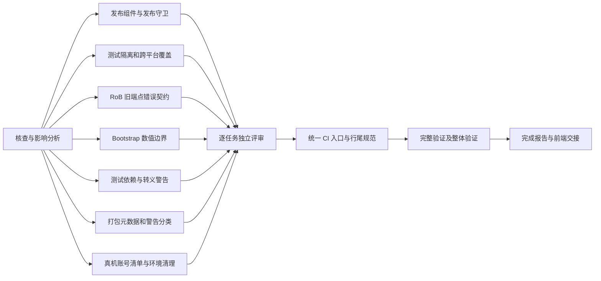

# ReviewFlow 2.1.6 维护实施方案

> **For agentic workers:** REQUIRED SUB-SKILL: Use subagent-driven-development or executing-plans to implement this plan task-by-task. Steps use checkbox (`- [ ]`) syntax for tracking. 本轮由主控写方案、裁决和调度；具体代码由子智能体完成。

**Goal:** 修复 2.1.5 发布后核查发现的维护问题，恢复可信的跨平台测试覆盖，并为需要用户设备、账号或前端团队的事项提供可直接执行的验收和交接材料。

**Architecture:** 按发布、测试隔离、产品契约、数值计算和环境验收拆为独立任务。不同文件可并行开发，同文件严格串行；每项先影响分析，再实现、独立评审，最后汇合到与 CI 一致的完整验证。

**Tech Stack:** Python / FastAPI / Starlette / NumPy，Node / Playwright，GitHub Actions，Windows 安装包、macOS DMG、Linux AppImage。

## Global Constraints

- 基线：`80dd35fd3a8833bb5fa81eb3ae7b85057fd25a22`；维护分支：`maintenance/2.1.6-20261114`。
- 当前版本号及已发布的 `v2.1.5` 发行版不在本轮改写范围；版本升级在新版本发布准备时统一办理。
- 不 commit、push、创建或移动标签、修改 GitHub Release、发送外部消息。用户已授权本地方案、开发、可逆环境清理、验证和评审。
- 修改任何已有函数、类、方法前，必须运行 GitNexus upstream impact 并报告直接调用者、受影响流程和风险；HIGH/CRITICAL 先向用户报告，再修改。
- GitNexus 已在本轮刷新到基线；FTS 扩展不可用。概念检索先尝试 query，失败记录限制，再用精确 context/impact 和有范围的代码检索；不并发重建索引。
- `custom_frontend/` 全部只读；本团队交付后端、测试、契约及逐组件/逐词典键的前端交接规格，前端实施由既定前端团队承担。
- 不削弱安全、统计正确性、权限隔离和发布标签不可覆盖守卫；不增加 `skipIf(CI)`、全局忽略警告或扩大容差来掩盖失败。
- 正常样本的统计区间保持现有算法、随机数语义和数值结果；异常输入提前拒绝，不能把异常结果转换成有限数伪装成功。
- `httpx` 两个独立校验器的依赖保留；测试客户端迁移采用官方兼容路径，不能全仓替换导入。
- 每个开发任务拥有明确文件范围、独立临时数据根和端口；不修改真实研究数据库或现有凭据。
- 不触碰 `E:/rf215-auto` 的停泊候选和 `E:/rf215-final` 发布树；含 `users.db` 的其他目录只登记，不归入清理。
- 真机、账号轮换、三平台成品验证必须分别留证；桌面窄视口、模拟器、静态校验不能替代真机或成品运行。
- 只报告实际执行的命令、退出码和结果；未能验证的事项保留责任人及解除条件，不能核销为完成。

---

## 事实裁定与范围

| ID | 用户记录 | 当前裁定 | 本轮处理 |
|---|---|---|---|
| REL-01 | Node.js 20 Actions 弃用 | 工作流仍使用旧组件；官方 Node24 元数据核对后选择版本 | 升级组件并验证上传、下载、汇集与校验文件路径 |
| REL-02 | release 分支无 publish 守卫，tag-f 风险 | publish 缺少 tag-only 守卫属实；基线已移除无条件强推、会拒绝移动既有异提交标签 | 加作业级守卫并保留原标签保护 |
| TST-01 | w4/r6 与串扰五件模块级状态泄漏 | 当前工作流为 5 个 `--ignore` 加逐文件分进程，不是 7 个 | 修污染源，证明整目录联跑后撤掉绕行 |
| TST-02 | 15 个 CI 跳过 | 最近 `e1df6d7`、`80dd35f` 已修部分跨平台假设；逐项核实残留 | 按能力、时区、浮点和浏览器来源修复，保留合理平台边界 |
| TST-03 | CRLF 污染旧记为 23 个测试文件 | 实测 build/tests 为 33 个 CRLF 加 1 个 mixed，共 34 个；另 build/script_manifest.cjs | 属性限定 build/ 等受控范围，保留既有规则，最后串行规范；不影响前端和字节夹具 |
| TST-04 | 分段电池漏静态测试 | 波末必须以完整 CI 命令决定结果 | 建立本地与工作流共享的完整验证入口 |
| ROB-01 | RoB 保存错误结构化 | 共享接口已有 `error_code/message_key/params`；旧编辑器保存接口仍按英文错误匹配 | 补旧端点契约与兼容，交接前端迁移清单 |
| DEP-01 | 两处 Python 无效转义 | 由警告原位确认，避免无关改写 | 只修说明文字字面量并定向验证 |
| DEP-02 | TestClient 弃用 httpx | 调查已确认 Starlette 支持优先导入 httpx2 并回退 httpx | 新增测试依赖；保留独立校验器 httpx；验证共存 |
| NUM-01 | Bootstrap 极端输入运算警告 | `coscreen/bootstrap_interval.py::bootstrap_pooled_interval` 已拒绝无效最终结果；还需核对中间计算 | 提前识别不可计算输入，证明正常结果一致 |
| PKG-01 | PyInstaller 可选/其他平台模块缺失 | 警告不等于成品缺功能 | 分类证据；统计、排序、图表成品验证之前不盲目删收集项 |
| PKG-02 | AppImage 缺 AppStream | 可独立增加软件中心元数据 | 加元数据、安装路径与校验 |
| OPS-01 | 打标前查最近三平台全绿 | Run #34 已被只读公开 API 核对为 success，提交为 80dd35f | 写入可执行发布检查表，核对待打标提交与实际验证提交 |
| OPS-02 | authfe 空壳、attr 对照树 | 调查确认 authfe 是空目录；attr 干净且无独有提交 | 二次核对后只做可恢复清理并记录恢复命令 |
| EXT-01 | iOS Safari/键盘/安全区 | 现有证据仅桌面 Chromium 窄视口；无真机结果 | 交付逐项真机验收单，等待设备证据 |
| EXT-02 | Jev 测试钥匙轮换 | 用户账号事项，仓库无完成证明 | 提供不含密钥的操作/验收清单，等待用户确认结果 |

核查证据：`out/maintenance216/recon_release.md`、`recon_tests.md`、`recon_product.md`、`recon_external.md`。各报告为证据记录，执行裁决以本方案和调度台账为准。

## 调度与依赖

- 主控：方案、接口裁决、文件所有权、风险沟通、评审意见复现裁定及汇总。
- 常规开发采用既定 DeepSeek / GLM 异构分工；安全性质的发布守卫由 GLM 开发、DeepSeek 复核。机械性文档和属性工作可用 Flash。
- 2026-11-14 用户最新裁定：本会话 Agent 不能热加载带模型的新类型，恢复可明确选模型的独立会话，优先复用已有会话减少安全审核；用 `ReadSession` / `WaitSessions` 集中监控。本会话已运行的复杂调查/数值任务继续完成。简单开发用 GLM-5.3-Flash/DeepSeek，安全相关开发用 GLM-5.3，交付由不同模型（如 DeepSeek/GPT-6.1-Terra）评审。`/workflow` 工具未暴露，不声称已启动。
- 实现任务完成后提交文件范围、影响分析输出路径、验证日志和风险；不自行扩大文件所有权。共享文件的修改申请交主控串行分派。
- 评审使用独立上下文，分别裁定规格符合性与代码质量；发现需有路径、行号、触发条件和影响，修复后针对该项复核。

## Task 1: 发布组件与发布守卫（REL-01、REL-02）

**Files:**
- Modify: `.github/workflows/release.yml`。
- Read-only/run: `build/tests/test_r7_luna_release_static.py` 的既有权限守卫；实查没有固定 Action 版本的旧断言，不为升级机械改写无关测试。新增行为覆盖归下一项。
- Create: `build/tests/test_2_1_6_release_workflow.py`，仅补实际发布分支和资产完整性行为的缺口。
- Evidence: `out/maintenance216/task_release_report.md`。

**Interfaces:**
- Consumes: VERSION、现有三平台矩阵与 `reviewflow-*` 产物、GitHub 官方 `action.yml` 的 `runs.using`。
- Produces: 分支推送和手动演练完成构建、只读产物汇集与校验并上传演练包；只有 push 版本标签事件可进入写权限 publish 作业。具体 assemble→publish 接口由 Task8 补充规格约束。
- 向 Task 8 提供现有完整命令集合；该任务完成前不提前删除五项测试绕行。

- [ ] 核对官方 Action 元数据与兼容性，将 checkout、setup-python、upload/download-artifact 和 release action 升到原生 `node24` 版本；报告保留官方 URL 和确切版本。
- [ ] 在 publish 作业设置 `if: github.event_name == 'push' && startsWith(github.ref, 'refs/tags/')`，构建作业继续允许 release 分支和 `workflow_dispatch` 演练；手动选择标签进行演练也不能进入 publish。
- [ ] 保留触发标签与 VERSION 一致、远端既有异提交标签拒绝移动、同提交幂等重跑和非强制推送的守卫。
- [ ] 保留 build 只读权限、checkout 不持久化凭据和 publish 最小写权限。
- [ ] 核对三份安装包、三份清单、SHA256SUMS 的上传/下载路径与缺失即失败规则；发布前拒绝资产不完整。
- [ ] 用本地工作流解析、事件条件用例、已有标签守卫及临时裸仓库行为检查证明修改；不触发远端发布。

## Task 2: 测试隔离与跨平台覆盖（TST-01、TST-02）

**Files:**
- Modify/Create: `build/tests/conftest.py`，仅在证据支持时增加作用域明确的隔离。
- Modify: `build/tests/test_w4_study_design.py`、`test_r6_undo_collab_fixes.py`、`test_2_1_5_ai_formats.py`、`test_2_1_5_auth_remember_reset.py`、`test_upload_security_regression.py` 中实际污染源和资源生命周期。
- Modify: 核查报告逐项列出的残留 CI 跳过文件；实施前将准确清单登记到任务简报，不得与 Task 1 的发布测试或 Task 3/4 的新测试双写。
- Evidence: `out/maintenance216/task_tests_report.md`。

**Interfaces:**
- Consumes: 独立临时 `COBOOKSHELF_DATA_DIR`、已有测试配置、CI 自带 Playwright 路径。
- Produces: 不依赖模块导入先后、不泄漏环境和后端单例的测试；整目录单进程可收集并执行。

- [ ] 先在新建独立源码工作树（候选仅同步本任务文件）运行短序列，禁止主仓根联跑：已发现 w4 清理可 pop 掉目录设置并回落默认 data。设置绝对测试数据根、短 E 盘 TEMP/TMP，记录测试箱默认 data 初末态；默认目录意外写入判为隔离失败。污染文件/受害者正反顺序均须覆盖，并留环境、模块缓存、连接和依赖覆盖的泄漏证据。
- [ ] 将模块级环境设置迁到有恢复的 fixture；关闭 TestClient/数据库连接；恢复 monkeypatch、依赖覆盖与必要的模块缓存。禁止全局 reload 全项目或屏蔽异常。
- [ ] 逐项复核现存 `CI` 跳过；时区用 UTC 显式时间、浮点用与数值尺度匹配的误差、浏览器按实际模块能力探测、chmod 按操作系统语义处理。
- [ ] 确认上次跨平台修复已覆盖的项目保持关闭状态，不重复修改或恢复旧假设。
- [ ] 定向运行受影响短序列和独立文件。完整 `python -m pytest build/tests -q` 只在所有实现收口后由 Task 8 统一跑，避免并发长测争用。
- [ ] 给 Task 8 输出可以移除五个 `--ignore` 的证据与尚未解决的精确失败列表；未实际联跑前不能宣称隔离已完成。

## Task 3: RoB 保存错误契约与前端交接（ROB-01）

**Files:**
- Modify: `custom_backend/main.py` 的旧 `PUT /api/tasks/{task_id}/analysis/risk-of-bias` 保存路径及其必要错误构造函数。
- Read-only reference: `custom_backend/rob_shared_api.py`、`custom_frontend/analysis_rob_editor.js` 和通用 API 错误提取。
- Create: `build/tests/test_2_1_6_rob_save_errors.py`。
- Create: `docs/maintenance/2.1.6_frontend_handoff.md`。
- Evidence: `out/maintenance216/task_rob_report.md`。

**Interfaces:**
- Consumes: 既有共享 RoB `error_code/message_key/params` 约定与 legacy 错误文案。
- Produces: 旧保存路径提供稳定机器码和参数，同时旧客户端仍可显示原有可读错误；HTTP 状态、权限和存储结果保持原语义。

- [ ] 对旧保存路由、现有错误 helper 和将改的任何存储函数运行 upstream impact；报告直接调用者、执行流程和风险后再改。
- [ ] 列举保存失败分支，确定机器码、参数名、原文案和 HTTP 状态的映射；同义错误复用现有码（如 `invalid_overall`、`source_unlinked`），其他码与真实校验语义一致。
- [ ] 旧端点使用独立翻译键命名空间 `analysis.rob.legacy_save.<error_code>`，`message` 与 `details` 逐字保留旧英文原文（含域名后缀）。现有客户端会先尝试键控翻译，再用 `T(message)` 回退；旧编辑器迁移前不把这些新键注册到全局翻译语料，避免提前翻译导致其英文匹配失效。不得碰全站 `_bad` 或存储 `save_rob`。
- [ ] 新增 API 测试断言结构化 detail、机器码、参数和原消息。兼容核查对照实际 `index.html:5504` 的 dict 分支与 `:5512` 的 string 分支，确认新键无旧语料命中，二者使用同一原消息回退。
- [ ] 通过真实 TestClient 路由覆盖有效保存、无效工具/字段/判断值、缺失文章/任务、权限错误和既有结构化失败，断言失败不写入无效数据。
- [ ] 在交接文档列出 `analysis_rob_editor.js` 保存错误展示组件、每个后端码、参数和词典键；规定先按机器码映射、再按兼容文本回退，未知错误不误报保存成功。
- [ ] 前端改动清单逐项列明十语言词典键、参数插值、回退行为及浏览器验收断言。现有 `ApiError` 已暴露 `errorCode/messageKey/params`（`index.html:5522`），不重复开发；前端团队先让 `analysis_rob_editor.js::serverError` 消费这些字段，再在同一交付中登记新键及更新词典资产令牌，旧服务器英文匹配回退保留。本团队不写 `custom_frontend/`。

## Task 4: Bootstrap 异常输入早拒绝（NUM-01）

**Files:**
- Modify: `coscreen/bootstrap_interval.py`。
- Read-only/run: `build/tests/test_r9_l5a_bayesian_intervals.py` 的既有极端输入和三模型基线；本任务不编辑该文件，新增断言归下一项新测试文件，避免与跨平台修复双写。
- Create: `build/tests/test_2_1_6_bootstrap_boundaries.py`，仅补现有测试未决定的数值行为。
- Evidence: `out/maintenance216/task_bootstrap_report.md`。

**Interfaces:**
- Consumes: `bootstrap_pooled_interval` 的现有参数、估计方法和随机数语义。
- Produces: 正常样本一致的区间与返回结构；不可计算样本明确拒绝，中间溢出不形成运行时警告泄漏或错误成功结果。

- [ ] 对拟修改的统计函数运行 upstream impact 并向主控报告风险。
- [ ] 记录极端样本触发 overflow/invalid 的最小输入和原先拒绝路径，不把正常用户样本扩大为拒绝范围。
- [ ] 在危险运算之前检查可计算性，或在局部 `np.errstate` 下计算并检查有限性，保留现有拒绝分支和错误类别；不得全局 `warnings.filterwarnings` 或 `numpy.seterr`。
- [ ] 2026-11-14 影响核查发现成功结果可含 `boot_summary.sd=inf`（合法有限输入、se 约 1e153）。主控裁定它属于错误输出，不能以“保持接受域”为由原样保留。对可表示的均值/标准差采用稳定计算，仅在实际需要的极端范围启用，正常路径和随机数消耗保持不变；仍不可表示的结果按明确 ValueError 拒绝。
- [ ] 对原失败样本使用 `RuntimeWarning` 作为错误验证，断言按既有错误类别拒绝；对原先带 inf 的结果验证所有返回统计量有限（允许现有合法 null），且 `json.dumps(..., allow_nan=False)` 成功，禁止只给溢出加 ignore 后仍返回 inf。
- [ ] 对固定随机种子的正常样本、不同估计方法与零方差边界比较修复前后区间；9.48e153 的合法效应量边界及原可计算大 SE 区间应保持，拒绝正常可表示输入或改变随机数消耗顺序必须先交主控裁决。

## Task 5: 测试客户端依赖与说明文字警告（DEP-01、DEP-02）

**Files:**
- Create: `build/requirements-test.txt`，声明完整验证额外依赖，复用 `requirements-app.txt` 的约束。
- Modify: `coscreen/evidence_mapper.py:1`、`build/tests/test_prisma_frontend_parser.py:1`，仅给模块说明文字加 raw-string 前缀，保持业务代码行为；evidence_mapper 原说明中的 `\b` 退格会修正为字面正则 `\b`（独立评审核实的预期文字差异）。
- Read-only reference: `build/validate_team_prisma.py`、`build/validate_screening_rounds.py`。
- Evidence: `out/maintenance216/task_dependencies_report.md`。

**Interfaces:**
- Produces: `python -m pip install -r build/requirements-test.txt` 可准备完整验证；httpx 与 httpx2 共存，TestClient 使用官方首选后端。
- Task 1/8 将此文件接入工作流和本地说明，避免多处依赖字符串漂移。

- [ ] 在 `requirements-test.txt` 复用 `-r requirements-app.txt`；明确 `httpx>=0.27,<0.29`、`httpx2>=2.13,<3`，并给 pytest、pyyaml 设实测兼容的主版本约束。Starlette/FastAPI 运行库上界保持原样。
- [ ] 在独立验证环境安装并记录版本，不随意升级用户既有全局环境。
- [ ] 验证 TestClient 正常请求、异常响应、生命周期和登录会话行为；将该弃用警告提升为错误确认不再出现。
- [ ] 两个直接导入 httpx 的校验器仍按原库运行；不进行全仓导入替换。
- [ ] 只改两处说明文字转义；用编译警告检查确认原 SyntaxWarning 消失，不新增镜像实现的测试。

## Task 6: AppStream 与打包警告分类（PKG-01、PKG-02）

**Files:**
- Modify: `build/build_linux.sh` 的 AppDir 元数据安装部分。
- Create: `build/reviewflow.appdata.xml`（若现有打包约定使用 metainfo 文件名则统一选其标准命名并在报告登记）。
- Read-only reference: Linux/macOS PyInstaller spec/脚本与成品验证器。
- Evidence: `out/maintenance216/task_packaging_report.md`。

**Interfaces:**
- Produces: AppStream XML 进入 AppDir 标准目录且桌面 ID、应用名、许可和项目链接一致；现有统计/排序/图表能力不因盲目删依赖而受损。

- [ ] 核对现有 `.desktop` 文件的 application ID、Exec、Icon 与项目元数据。
- [ ] 增加 `usr/share/metainfo/` 标准 AppStream 元数据并在打包路径安装，采用真实项目链接与许可，避免虚构截图或发行记录。
- [ ] 对 XML 解析及 AppDir 安装路径做定向验证；有 `appstreamcli validate` 时运行并留证，无工具则明确平台验证限制。
- [ ] 将日志缺失模块分为平台专用、真正可选、需成品验证三类，记录证据和需要测试的功能。
- [ ] 为成品统计计算、四类排序与 Cairo PNG 图表导出列出可复现运行步骤；取得对应平台成品证据之前不删除收集项。

## Task 7: 外部验收、发布纪律与可恢复环境清理（OPS-01/02、EXT-01/02）

**Files:**
- Create: `docs/maintenance/2.1.6_external_acceptance.md`。
- Create: `docs/maintenance/release_checklist.md`。
- Environment targets: 仅 `E:/rf215-authfe`、`E:/rf215-attr`。
- Evidence: `out/maintenance216/task_external_report.md`。

**Interfaces:**
- Consumes: `recon_external.md` 的元数据检查与 Run #34 公开状态。
- Produces: 可执行真机/账号验收单、打标检查表和环境清理记录；不能代写不存在的用户确认。

- [ ] 写 7 项 iPhone Safari 验收：登录进入工作流、键盘遮挡与回弹、安全区、触控命中、系统文件选择器、横竖屏与锁屏恢复、截图/机型/iOS 版本留痕。
- [ ] 写 Jev 账号侧轮换步骤及完成标准：旧钥匙失效、新钥匙功能验证，仅记录日期和结果，不收集或入库新旧钥匙值。
- [ ] 发布检查表要求核对待发布提交、三平台最近构建结果、runner 镜像存续、成品/清单/校验文件完整；先演练构建，最终发行仍需用户明确发布指令。
- [ ] 再次确认 authfe 空目录后尝试移除；再次确认 attr 无修改/未跟踪/独有提交后用不带 force 的 `git worktree remove`；状态改变即停止该清理，不扩大目标。
- [ ] 报告清理前后工作树列表与恢复命令：`mkdir E:/rf215-authfe`；`git worktree add --detach E:/rf215-attr 2230523`。
- [ ] 设备或账号尚不可用时，保留待验状态与用户操作责任，不以清单交付替代实测核销。

## Task 8: 统一 CI 入口与行尾规范（TST-03、TST-04）

**Files:**
- Create: `build/run_validation.py`，作为完整验证唯一入口。
- Modify: `.github/workflows/release.yml`，本任务在 Task 1 工作流修改交付后独占该文件；新增只读 assemble 作业以使演练覆盖完整资产链。
- Modify: `build/tests/test_2_1_6_release_workflow.py` 的新作业图、动作使用集合和 checksum 行为测试；Task1 已停笔，七个标签沙箱行为保持。
- Design contract: `out/maintenance216/task8_asset_assembly_spec.md`，约束 assemble 下载合并/六载荷/SHA/完整演练包，以及 publish 下载完整包后先校验再远端写。
- Modify: `build/build_windows.bat`、`build/build_macos.sh`、`build/build_linux.sh` 的校验器接线；Linux 脚本在 Task 6 完成后串行接手。
- Modify: `build/tests/test_r7_mm7_relchain.py`、`test_r7_lastfix_ci.py`、`test_r10_u5_copy_lane.py`、`test_w4_study_design.py` 的工作流接线断言；w4 在 Task 2 后串行接手。
- Modify: `build/tests/test_r8_fl8_build.py`、`test_r7_dayfix_build_scripts.py` 的构建校验器 fixture 集合，保护新增两个校验器的接线。
- Modify: `.gitattributes`，保留现有 F1-10 规则及其缩小作用域的理由。
- Modify: 实测存在 CRLF 的受控测试文件；仅在其他开发任务停止编辑后串行规范。
- Modify: `docs/maintenance/release_checklist.md` 中本地验证命令，接续 Task 7 后串行处理。
- Evidence: `out/maintenance216/task_integration_report.md` 与 `out/maintenance216/validation/`。

**Interfaces:**
- Consumes: Task 1 当前的 4 个发布校验器、全部 pytest/Node 单测命令；Task 2 隔离证据；Task 5 测试依赖文件。
- Explicit scope extension: 将原先漏接线的 `build/validate_team_prisma.py` 与 `build/validate_evidence_locale_static.cjs` 纳入完整门禁，合计六个；它们须先在基线单独运行留证，再接入本地入口、CI 和三个打包脚本，不能只更新清单。
- Produces: 同一解释器和 Node 执行的完整命令计划；本地与 Actions 调用同一入口，任何非零退出都失败；逐命令日志便于复核。

- [ ] 可先并行开发本任务独占的新入口、Windows/macOS 校验接线及两个假树 fixture；共享文件按各自交接逐个接手：release.yml 等 Task 1、Linux 脚本等 Task 6、w4 静态钉等 Task 2、release_checklist 等 Task 7 修复。行尾规范与完整门禁仍等所有开发停笔，不扩大同文件并发。
- [ ] 先单独跑新增接线的两个校验器，记录基线命令/输出/退出码；基线失败交主控分派修复，不改弱断言。随后接入 Python 三个（import_review、screening_rounds、team_prisma）和 Node 三个（import_review_static、team_prisma_static、evidence_locale_static），保留现有全部 24 份 Node 单测。
- [ ] 将四份工作流静态钉改为核查两层实际事实：release.yml 在载荷验证之后调用唯一入口，入口的可执行命令计划覆盖整目录 pytest、六校验器与全部 Node 单测；检查真实 argv 列表或入口提供的只读命令计划，不靠在注释中复制旧命令骗过断言。打包脚本和对应 fixture 同步覆盖六个校验器；两个假树同时复制 Task 6 必需的 `build/reviewflow.metainfo.xml`，生产脚本缺模板失败的语义保留；保持步骤锚点可识别。
- [ ] 按补充规格增加 `assemble`（只读、needs build）和 `desktop-release-assets` 完整产物；分支/手动演练也实际执行汇集和 checksum。`publish` 改 needs assemble，push+tag 守卫保持，下载完整包后先验证 SHA 再任何远端写。相关动作全为原生 Node24，配置和提取真实脚本的行为测试同步验证。
- [ ] 入口执行完整 `python -m pytest build/tests -q`，不能仅跑人工挑选文件；Task 2 确认后移除五个 ignore/单文件绕行。
- [ ] 所有子进程以 argv 数组运行，Python 使用 `sys.executable`；输出命令、日志和退出码；可提供只列命令的只读选项，但正式验收必须实际运行完整入口。工作流既有 `RF_R9_TMP`、`RF_R9_TMP_ROOT`、`PYTHONUTF8` 和 macOS `DYLD_LIBRARY_PATH` 供给保留，入口子进程继承环境。
- [ ] 先以 `git ls-files --eol` 清点既有 blob 和工作树的实际行尾；保留现有 `.gitattributes` 的 F1-10 约束与注释。在明确类型范围内对 Python/Node/Shell/YAML/JSON/Markdown/XML 规定 LF，对 Windows 批处理按当前工具需要明确 CRLF，对二进制不做文本转换，不引入全仓 `text=auto`。
- [ ] 不使用全仓 `git add --renormalize` 混入未授权文件；仅规范明确受控文件，证明 `--ignore-space-at-eol` 没有非预期语义变动。
- [ ] 所有实际 pytest/API/完整入口执行都在新建独立源码工作树，基线加显式候选补丁与新文件白名单，验证导入来自测试箱并记录候选哈希；设置绝对 scratch 数据根、短 E 盘 TEMP/TMP 及 RF_R9_TMP/RF_R9_TMP_ROOT，核对默认 data 初末态，不在主仓联跑。
- [ ] 在修复稳定后运行完整入口一次，失败按精确日志回交文件所有者，不以新跳过或分段掩盖；修复后只重跑被修改影响的检查，直至完整结果可组成同一最终代码状态的证据。
- [ ] 运行 `git diff --check` 与 `node .gitnexus/run.cjs detect-changes --scope all`，确认只影响方案内文件和流程；额外检查新文件，避免 GitNexus 漏掉未跟踪文件。

## Task 9: 独立评审、清单核销与交接

**Files:**
- Modify: `out/release_plan/BACKLOG_2.1.6.md`，原五项保留来源，补齐所有维护项并逐项关联验收。
- Create: `out/maintenance216/RESULTS.md`。
- Update: 本方案的勾选状态与独占调度台账。

- [ ] 每个任务完成后换模型/上下文审查规格和代码；确认的错误回原开发者修复，复审后再进入汇合。
- [ ] 整体评审检查任务之间的接口、验证入口与工作流一致、老客户端兼容、无意外前端修改和无凭据泄漏。
- [ ] 核销表逐项给“完成并验证 / 待前端实施 / 待真机 / 待账号操作 / 待三平台演练”，附证据路径；不得把待外部验收的事项写成全部完成。
- [ ] 最终向用户交付方案、变更、验证结果、前端交接与外部动作清单；保持本地修改可直接审阅，不自行发布。

## 完成标准

1. 发布分支与手动构建不会获得发布写权限，版本标签才可发布；旧标签保护不回退。
2. CI 及本地以同一完整入口覆盖整目录测试和所有要求的校验器，不再依赖五个文件的串扰绕行。
3. 当前 CI 跳过逐项有证据、被合理能力判定替代或已有修复核实，不留下无说明覆盖缺口。
4. RoB 后端结构化错误可由真实请求验证，旧客户端可用，前端改动规格可直接实施。
5. TestClient 弃用与 Python 说明文字警告有定向验证；Bootstrap 正常区间保持一致，极端输入仍明确拒绝。
6. AppStream 元数据和打包警告有明确处理与验收证据；未验证的依赖收窄不能核销。
7. 外部事项有责任人、检查步骤和完成证据要求，环境清理可恢复，保留用户数据与停泊候选。
