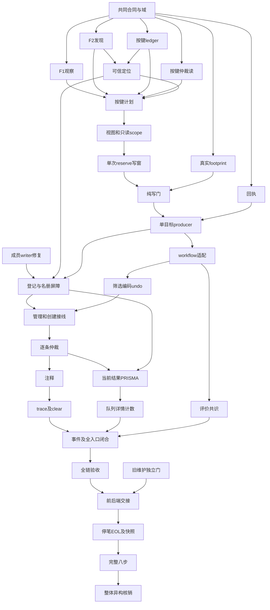

# ReviewFlow 2.1.6 剩余工作完整 DAG Implementation Plan

> **For agentic workers:** 执行时加载已列出的 `subagent-driven-development`，逐包进行影响分析、实现、规格/质量复审和受控验证。用户已选 DAG 子智能体执行；不再询问执行方式。本轮 Sol 只成稿，用户自行切当前会话为 Terra 后再开始调度。

**Goal:** 完成团队逐文献逐阶段推进与完成事实保留，接通所有相关保存/历史/仲裁/结果入口，并收口既有 2.1.6 维护候选的独立验收与完整本地验证，留下可核前端及外部交接。

**Architecture:** 已完成事实优先，未完成阶段使用当前明确名单。窄身份/来源/按键读取支撑受保护输入计划；最后票、仲裁和名册变更各在唯一业务目标提交内保存完成依据。队列、保存门、当前结果与 PRISMA 共用同一逐键服务；历史清空保留专用多分区提交边界。

**Tech Stack:** Python 3.12.13 验证环境、stdlib SQLite、现有 FastAPI/Pydantic、pytest/unittest、现有 Node 验证入口；四类 worker：g-flash、luna、oc-ds、cc-ds；不增加第三方依赖。

## Global Constraints

- `custom_frontend/` 全部只读；交付精确规格，不实施前端代码/词典。
- 真实 data/数据库/密钥/8613 不碰；不从 `E:/mubi-reviewflow` 启动产品/API/pytest。新 scratch 从进程启动 cwd 起隔离，Python `-I -B`。
- 不 add/commit/push/tag/release、不改版本；当前版本仍 2.1.5。本计划不扩展 AI HTTPS 专项推送授权。
- 不复制 data、DB、密钥、.git、缓存、工具残留进入验证源箱；不读 agent output/transcript，不停不明进程，不绕过拒绝或改权限/模型配置。
- 旧箱、原 raw/status、暂停包、restart ZIP 和隔离区只读；不动 rf215-auto/rf215-final，不擅自恢复 legacy-shell-quarantine。
- 改每个函数/类/方法前实际 upstream impact；HIGH/CRITICAL 必须改前报告用户。共享索引旧、FTS 缺失、符号未入图要如实 UNKNOWN，不能当零影响；不重建索引/修 FTS。
- 不以任何内部 agent 通知、accepted/queued 或本文措辞冒充真人批准。当前授权为完整规划；后续用户切换模型/指示进入协调后实施。

## 1. 入口与权威顺序

1. 人类业务权威：[修复合同 v2](../../maintenance/TEAM_FLOW_REPAIR_CONTRACT_20261114.md) §8/§9。
2. 本计划是新的总入口，覆盖旧暂停状态、临时模型路由和不再适用的工作包先后；保留旧文件作历史，不覆暂停包。
3. [接口与事务合同](2026-11-16-2.1.6-team-contracts.md)（C01–C12）：接口名称、版本、来源/事务/错误边界的单一权威。
4. [逐包实施单](2026-11-16-2.1.6-team-work-packages.md)：每包文件、输入输出、步骤、测试样例和验收。
5. [验证与交接](2026-11-16-2.1.6-validation-handoff.md)：执行证据、旧维护候选、完整八步、FE/外部门。
6. 机器图 `out/maintenance216/dag_plan_20261116/DAG.json` 从下表和文件所有权表生成；它是便于检查的派生物，文档修订后重生成并重新检查，不能自行漂移。

规划依据为当前三份已交事实报告：FACTS_INPUTS_CC.txt、FACTS_ENDPOINTS_FLASH.txt、FACTS_RESULTS_VALIDATION_LUNA.txt（均在上述 out 目录）。它们是静态事实，不是产品或测试通过证据。补充旧维护状态另见 FACTS_MAINTENANCE_CARRYOVER_LUNA.txt。

## 2. 开始时状态：保留已完成，不重开旧矩阵

基线：`maintenance/2.1.6-20261114`，HEAD `80dd35fd3a8833bb5fa81eb3ae7b85057fd25a22`。既有大量 dirty/untracked 修改保留；这不是干净提交候选。

| 基础件 | 当前冻结 SHA-256 | 已证状态与本计划处理 |
|---|---|---|
| team_terminal_facts.py | 73c58e0ae6b86d5430e7921e7f47acc01ab5e3d5afd53fd9b531f7aa6d73149c | F1 基础存储限定 PASS，54 OK/54 passed+132 subtests；P02 只增加观察兼容，修改后才合理回归相关旧测试 |
| test_s2_terminal_facts.py | 9c17f442c36cdef8081c1aa2247240686e417e592068f7c8df9ef62e3d7471a5 | 原 54 方法保留，不为新来源放宽旧断言 |
| team_terminal_registry.py | ee3cf63b5c9e060cea02b23e4a393b143dba57421e18511610265b2ae7f6d3c6 | F2 基础存储限定 PASS，39 OK/39 passed+37 subtests；P03 加窄发现，不改旧强 API |
| test_s2_terminal_registry.py | 7187646da5d8a5503d587e5886cd55b58b03cd7b524904af3a7d6fe8169f29cd | 原 39 方法保留 |
| task_collaboration.py | 1ab3761bc1fa4b9e38f816418a087b56e3b63b108e587716423bc483499bff07 | 成员 writer 仍两项静态 FAIL；FIX-R2 未实施，由 P01 收口 |
| test_s2_management_connection_writes.py | a9699539805755933beb84818b50991b63d16c3c19f75da50574c34c15fcc53b | 18 方法仅作者静态交付，未独审/未运行；P01 先审再增量 |

A1 借用 writers、B1 保留资源、既有角色/资格基础、history 原语、trace prepared 与 C1 evidence read seam 沿各关闭记录继续使用，**不重做完整旧开发/旧运行**。新改动触达旧件时才运行有因果关系的回归。F1/F2 原关闭限制、旧失败 raw 和 INDEX 纠正记录继续有效，不升级为整树通过。

关键未接事实：retained_team_write_inputs/require_team_write 无生产 caller，ctx.write_inputs 无 producer；session finish 仍两段提交且没写 attestation；PRISMA 全表+stage-global latest；SSE 无筛选完成通知。必须接线，不能以基础 API 已存在核销。

## 3. 文件结构与职责

| 范围 | 文件及用途 |
|---|---|
| 共同类型/owner 域 | 新 coscreen/team_flow_types.py；新 custom_backend/team_keyed_domain.py |
| 完成/来源/票/仲裁窄读 | 既有 team_terminal_facts.py、team_terminal_registry.py、team_vote_ledger.py、screening_arbitration.py |
| 来源生命周期 | 新 custom_backend/team_source_lifecycle.py：token、显式准备/adoption、登记、归档/退休证明、管理协调；P06→P14 串行 |
| 请求回执 | 新 coscreen/team_flow_receipts.py：借用连接的不可变回执及内部证据；不替换旧 research_trace |
| 按键输入 | 新 custom_backend/team_keyed_inputs.py：短读发现/依赖计划，不负责提交；既有 team_screening_write.py：一次 reserve/最终重验 |
| 只读/视图 | 既有 team_screening_runtime.py；新 custom_backend/team_keyed_reads.py：只读事务屏障 |
| footprint/检查/提交 | 新 custom_backend/team_write_footprints.py；既有 team_write_checks.py；新 custom_backend/team_flow_commit.py |
| 实际路由 | review_workflow_api.py、main.py、workspace_undo_api.py、appraisal_api.py、coding_consensus_api.py、arbitration_session_api.py、research_trace_api.py、task_package_api.py |
| 逐条仲裁存储 | 既有 coscreen/arbitration_session.py，新 team borrowed 分支；不重写 generic CSV/session 算法 |
| 多分区历史清空 | 新 custom_backend/team_completion_clear.py；扩现有 prepared clear 协调，不套 B1 多目标 |
| 当前结果 | 新 custom_backend/team_current_results.py；prisma_task_metrics.py；保 raw/history 消费路径 |
| 最终验收 | 独立新测试文件、docs 交接、受控 .gitattributes/EOL、build/run_validation.py 原八步 |

新增模块遵单向依赖：types → 低层/域/locator → keyed plan → runtime/read scopes → write scope/checks → commit/lifecycle → workflow/路由 → 结果与交接。runtime 不能导入 write/checks；keyed plan 不能导入 write scope；只读 scope 不能借 B1 伪 commit。若要复用现有只读身份 helper，避免反向 import，不进行无关大拆文件。

## 4. DAG 与模型分工

下表中的依赖均指 **ACCEPTED**，不是“作者写完”或“已派单”。`-` 表示无前置。产品审查与作者异构；测试审查另见逐包统一门，OC/CC 同为 DeepSeek，不能互算异构。执行者统一从 g-flash 的新上下文取，证据核验用独立 DeepSeek 或 Luna。

<!-- DAG-TASKS-BEGIN -->
| ID | 工作包 | 依赖 | 作者 | 产品/主审 | 测试作者 |
|---|---|---|---|---|---|
| P00 | 共同类型与owner按键域 | - | luna | cc-ds | g-flash |
| P01 | 成员borrowed writer FIX-R2 | - | luna | cc-ds | g-flash |
| P02 | F1 current_observation兼容 | P00 | luna | oc-ds | g-flash |
| P03 | F2最低身份及逐来源发现 | P00 | oc-ds | luna | g-flash |
| P04 | ledger身份头及按键票面 | P00 | cc-ds | luna | g-flash |
| P05 | 仲裁按键读取与未知范围 | P00 | oc-ds | luna | g-flash |
| P06 | 可信来源token与历史定位 | P03,P04 | luna | cc-ds | g-flash |
| P07 | 目标库回执与内部证据 | P00 | cc-ds | luna | g-flash |
| P08 | 按键发现及依赖计划 | P02,P03,P04,P05,P06 | luna | cc-ds | g-flash |
| P09 | 键级视图及受保护只读scope | P08 | luna | oc-ds | g-flash |
| P10 | 写窗裁剪及一次reserve重验 | P09 | luna | cc-ds | g-flash |
| P11 | 历史及artifact真实footprint | P00 | oc-ds | luna | g-flash |
| P12 | 统一纯检查及删除补首票例外 | P10,P11 | cc-ds | luna | g-flash |
| P13 | 单目标mutation完成producer | P07,P12 | luna | cc-ds | g-flash |
| P14 | 显式准备adoption及名册屏障 | P01,P06,P07,P09,P10,P13 | luna | oc-ds | g-flash |
| P15 | workflow写适配器 | P13 | cc-ds | luna | g-flash |
| P16 | 筛选编码evidence和undo路由 | P15 | oc-ds | luna | g-flash |
| P17 | appraisal及coding共识路由 | P15 | cc-ds | luna | g-flash |
| P18 | 创建邀请repair与五管理入口 | P14,P16 | luna | cc-ds | g-flash |
| P19 | team逐条仲裁单提交 | P05,P13,P18 | luna | oc-ds | g-flash |
| P20 | 注释增改删同阶段保护 | P11,P13,P19 | cc-ds | luna | g-flash |
| P21 | trace恢复删除及多分区clear | P11,P13,P20 | luna | oc-ds | g-flash |
| P22 | 当前团队结果及PRISMA | P09,P14,P19 | oc-ds | luna | g-flash |
| P23 | 队列详情计数统一消费 | P15,P22 | cc-ds | luna | g-flash |
| P24 | SSE活动投影及真实入口闭合 | P17,P18,P19,P20,P21,P22,P23 | luna | cc-ds | g-flash |
| P25 | 全链API和竞争验收矩阵 | P24 | g-flash | luna | g-flash |
| P26 | 旧维护候选独立门核销 | - | cc-ds | luna | g-flash |
| P27 | 精确FE及外部交接 | P25,P26 | g-flash | cc-ds | - |
| P28 | 停笔后受控EOL和候选快照 | P27 | g-flash | cc-ds | - |
| P29 | 共同候选完整八步 | P28 | g-flash | luna | - |
| P30 | 整体异构复核与证据核销 | P29 | oc-ds | luna | - |
<!-- DAG-TASKS-END -->

图为可读摘要；完整依赖以表为准。

## 5. 文件互斥是实际依赖

<!-- DAG-LOCKS-BEGIN -->
| 互斥文件/资源 | 串行所有者 |
|---|---|
| coscreen/team_flow_types.py | P00 |
| custom_backend/team_keyed_domain.py | P00 |
| coscreen/task_collaboration.py | P01 |
| coscreen/team_terminal_facts.py | P02 |
| coscreen/team_terminal_registry.py | P03 |
| coscreen/team_vote_ledger.py | P04 |
| coscreen/screening_arbitration.py | P05>P19 |
| custom_backend/team_source_lifecycle.py | P06>P14 |
| coscreen/team_flow_receipts.py | P07 |
| custom_backend/team_keyed_inputs.py | P08 |
| custom_backend/team_screening_runtime.py | P09 |
| custom_backend/team_keyed_reads.py | P09 |
| custom_backend/team_screening_write.py | P10 |
| custom_backend/team_write_footprints.py | P11 |
| custom_backend/team_write_checks.py | P12 |
| custom_backend/team_flow_commit.py | P13 |
| custom_backend/review_workflow_api.py | P15>P23 |
| custom_backend/workspace_undo_api.py | P16 |
| custom_backend/main.py | P16>P18>P19>P20>P21>P24 |
| custom_backend/task_package_api.py | P18 |
| custom_backend/appraisal_api.py | P17 |
| custom_backend/coding_consensus_api.py | P17 |
| coscreen/arbitration_session.py | P19 |
| custom_backend/arbitration_session_api.py | P19 |
| custom_backend/research_trace_api.py | P21 |
| custom_backend/team_completion_clear.py | P21 |
| custom_backend/team_current_results.py | P22 |
| custom_backend/prisma_task_metrics.py | P22 |
| .gitattributes | P28 |
| build/run_validation.py | P26>P28 |
| .github/workflows/release.yml | P26>P28 |
| build/build_linux.sh | P26>P28 |
| build/build_macos.sh | P26>P28 |
| build/build_windows.bat | P26>P28 |
<!-- DAG-LOCKS-END -->

- P26 先只读审候选；如需产品修复，拆 R26 子包并登记确切文件锁。可能与后续 main.py/appraisal_api.py 重叠时，必须等对应 owner 交付才接手，不抢写；P27 依赖所有 R26 关闭。不能把泛称“maintenance”当整树写权。
- P28 对所有源/测试的 EOL 写权只在其他作者、复审修复全部停笔后取得。只改实测白名单字节，AST 不变；不能并发规范其他人正在写的文件。
- 每个新测试文件唯一作者；P01 的旧 18 方法先独审，不覆盖旧候选或删断言。测试与产品可在合同冻结后并行；同文件修复仍串行。

## 6. Terra 的调度规则与第一批

1. 用户切当前会话后，Terra 先读本文件、合同、逐包单和当前状态；核 HEAD/六基线是否漂移，仅检查字节/状态，不重跑 F1/F2。没有漂移就用最新接受交付，不恢复旧 agent 才能推进。
2. 首批 **P00、P01** 可分别由两个 Luna 作者处理；各自测试由两个 g-flash 新上下文。P26 可先派 cc-ds 只读收证，Luna 复审等有空位。P02 等 P00 后进入；不先同时铺 31 包。
3. 后续取所有依赖 ACCEPTED、文件空闲的 READY 包。默认上限 luna=2、oc-ds=4、cc-ds=4、g-flash=4；服务若拒绝以实际限制为准，不用满并发为目标。长 SQL/API/测试执行全局一份租约，不能同时跑多个。
4. 每个作者一个当前包，一个阶段。先 IMPACT_AND_PLAN；主控读改前风险并向用户通报后发 CODE 指令。新文件/测试 helper 也实际 impact；UNKNOWN 留 raw。不要反复追加交叉阶段任务。
5. 作者 SOURCE_FROZEN、测试 TEST_FROZEN 后，分别派异构新上下文规格/质量审查。测试复审优先 DeepSeek；P01 测试含原 DeepSeek 作者，用 Luna 独审。g-flash 不独自承担最终质量放行。
6. 两侧独审 PASS 才发 RUN_PACKET；执行由独立 g-flash 上下文，证据审由不同模型上下文。作者 AST/compile、作者局部绿、accepted/queued 都不是 ACCEPTED。
7. 等自然交付通知，不轮询、盲杀、重复派职责。无独立待办时休眠。Agent/SendMessage 优先；不为普通任务 CreateSession。
8. 收到反例后主控核真实失败，回原文件 owner 做最小修复。连续两轮同根因失败先拆诊断包/缩小接口；不盲目继续扩大断言矩阵。第 5 轮仍不闭合时由 Terra 主控出收敛裁定/再拆包，不放宽人类规则或清掉失败 raw。
9. 任务新增文件/符号必须先改包的范围、文件锁与影响计划；主控有维护授权可以做范围内技术裁定，无须重复问用户。外部发布/远端动作仍不得借此启动。

## 7. 单包状态、交付与验收

状态机：`BLOCKED → READY → IMPACT → CODE → SOURCE_FROZEN/TEST_FROZEN → REVIEW → RUN_READY → RUNNING → EVIDENCE_REVIEW → ACCEPTED`。失败记 REWORK；外部依赖用 EXTERNAL，不用“进行中”混淆。

每包固定目录 `out/maintenance216/dag_exec_20261116/<ID>/`，交付：

- `SCOPE.md`：输入合同/依赖交付 SHA、真实影响/风险、唯一文件锁；before/after、精确 patch、逐符号变化与 API/AST 差异。
- `TEST_PLAN.md` 与冻结测试 SHA/方法名清单；新测试对应真实可证风险，不镜像实现、不弱断言。
- `REVIEW_PRODUCT.md`、`REVIEW_TESTS.md`：Spec/Quality 分列、逐发现证据和已关闭状态；不写“应该通过”。
- `RUN_PACKET.json`、新 run 路径、原 stdout/stderr/status、runtime 源身份与清理门、`REVIEW_EXECUTION.md`。
- `DELIVERY.json`：status、依赖 hashes、实际改动文件、产物 hashes、测试原始退出码、限制、下一触发条件。

ACCEPTED 必须主控已读上述报告，接口与文件范围吻合，真实测试和清理门通过、证据审 PASS。一个包 ACCEPTED 只证明本包，不扩大到整个团队流程或发布。

## 8. 业务需求到工作包覆盖

| 人类要求/必要边界 | 实施包 | 必须出现的验收 |
|---|---|---|
| 完成按文献×阶段，不补票/重开 | P02,P09,P12,P13,P25 | 同阶段完成直写/undo 409；新 D 不能补 A 初筛 |
| 名单意见来源永久保留 | P03,P06,P14,P18 | 新增/移除/职责变化三类；旧集观察与新集首次一致来源不混 |
| 初筛纳入后新成员可复筛 | P09,P12,P16,P25 | D 无初筛票可复筛，不能改已完成初筛 |
| 属主无业务旁路，配置入口保留 | P01,P14,P18,P25 | owner coder/reconciler 各正负控；未配置可 repair/configure |
| A 就绪不被 B 未完成/坏 D 遮蔽 | P03–P10,P19,P22–P25 | 读 A+issue B；批写含 B 整批零写；见证坏不能用 cache |
| 全员一致/合法仲裁均完成 | P13,P14,P19,P25 | 最后一票与 F1 同 actor；仲裁四件套同 collab；include/exclude 都保留 |
| 双盲、逐条仲裁、desktop 可达 | P05,P19,P25 | A reveal 不含 B；B 变化不废 A；旧 CSV 暂停链正控 |
| 历史/轨迹对应阶段只读 | P11,P12,P16,P20,P21,P25 | 页面后完成的竞争；多分区后命中前零写；coding 正控 |
| 当前结果/PRISMA一致 | P22,P23,P24,P25 | 多键各自有效结论，raw/历史导出保持 |
| 纯读零写、未知非空、单目标提交 | P03–P14,P21,P25 | SQL authorizer/真实事务探针、commit 故障、清理真空 |
| FE规格与旧维护全门 | P26–P30 | 十语言参数表、八步共同候选、外部门逐条标注 |

## 9. 停止点与最终交付口径

P30 是“后端本地维护候选及其证据已收口”门。前端实施、三平台 native Actions、iPhone 真机、账号钥匙轮换分别有真实证据才关闭；未完成必须保留外部状态。没有发版/推送节点，不自动升级版本，不以本地全绿冒充外部全绿。

本轮交付计划后停在 `PLAN_DELIVERED / WAITING_FOR_USER_MODEL_SWITCH`。用户自行切 Terra；没有任何工具可改变已运行会话模型，不能仅因 prompt 写了 Terra 就声称已经切换或启动实施。
